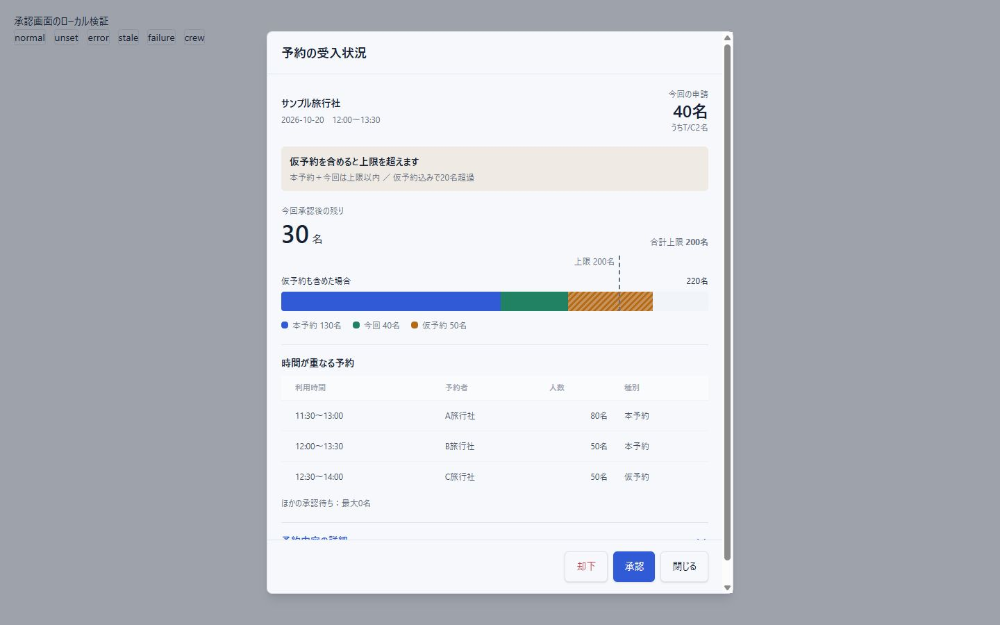

# 予約承認画面の実装記録（2026-10-16）

> 受入上限の設定先と集計方法は、後続の `17-global-settings-2026-10-16.md` により全体共通設定へ変更した。以下の店舗別上限に関する記述は変更前の記録。

## 対応内容

- 承認待ち予約の子画面を「予約の受入状況」に置き換えた。今回承認後の残り人数、合計上限、仮予約も含めた場合の積み上げバーを表示する。
- 時間が重なる予約は常時表示し、下部に「却下」「承認」「閉じる」を配置した。却下は確認後に実行する。超過・情報不足の場合の承認も確認を挟む。
- 「予約内容の詳細」を展開すると、保存された申請情報29項目を確認できる。予約者・会社・支店・担当者・連絡先、利用日時・人数・メニュー、予約担当者・当日連絡先、団体情報、T/C・D/G、支払条件、備考、同意情報などを含む。現在のアカウント情報ではなく予約に保存した情報を表示する。編集前の原本履歴を新設する機能ではない。
- 店舗管理に「受入上限（人数）」を追加した。未設定と0名を区別し、有効な店舗すべての上限を合計する。既存店舗に任意の上限は設定していない。

## 集計ルール

- 店舗未割当も含め、対象予約と時間が重なる予約を集計する。対象予約自体は既存分から除外する。
- T/Cは予約人数の内数という利用者の回答に従い、人数へ追加加算しない。D/Gも別途加算しない。
- 本予約・来店待ち・来店済み・キャンセル申請中を本予約として集計する。仮予約および仮予約から本予約への変更申請中を仮予約として扱う。キャンセル済み・却下済みは除外する。
- 時間帯ごとの同時利用人数の最大値で判断する。隣接する予約の終了時刻と開始時刻が同じ場合は重複させない。日跨ぎにも対応する。
- 終了時刻がない場合は設定済みメニューの利用時間を使う。時間を特定できない予約は保守的に集計して注意を表示する。
- 有効店舗がない場合や上限未設定の店舗がある場合は、合計上限・残り人数を未確定として表示する。
- 読込時と操作直前に管理者認証付きAPIで再取得する。表示後に情報が変わった場合は判断をやり直す。集計は判断補助であり、同時承認をDBで直列化する上限制御ではない。取得直後の別操作との競合を完全に防ぐものではない。

## DB・検証

- ローカル開発DBに `0004_acoustic_sharon_ventura.sql` を適用した。変更はstoreのnullable整数capacity列追加のみで、既存データを維持した。
- `npm test`: 114件成功。
- `npm run test:db:postgres -- --confirm reservation_system_test`: 30件成功。管理者認証、容量保存、申請情報、T/C非加算を含む。
- `npm run build`: 成功。型確認も成功。
- lint: エラー0件、既存の警告5件。
- 実コンポーネントを使用した隔離プレビューで、デスクトップ・幅390px、詳細展開、承認・却下確認、取得失敗、保存失敗、操作前の情報変更、上限未設定、T/C内数表示を確認した。実アカウントの予約変更・メール送信は実施していない。
- 既存の変更を保持し、コミット・公開は行っていない。クラウドDBや請求機能は今回の対象に含めていない。

## 利用開始時の確認

1. localhost:3000の店舗管理で、有効店舗それぞれの実際の受入上限を保存する。
2. 承認待ち予約を開き、人数・時間が重なる予約・詳細を確認する。
3. 承認または却下を選ぶ。既存の通知動作を引き継ぐため、動作確認には検証用の予約を使用する。

