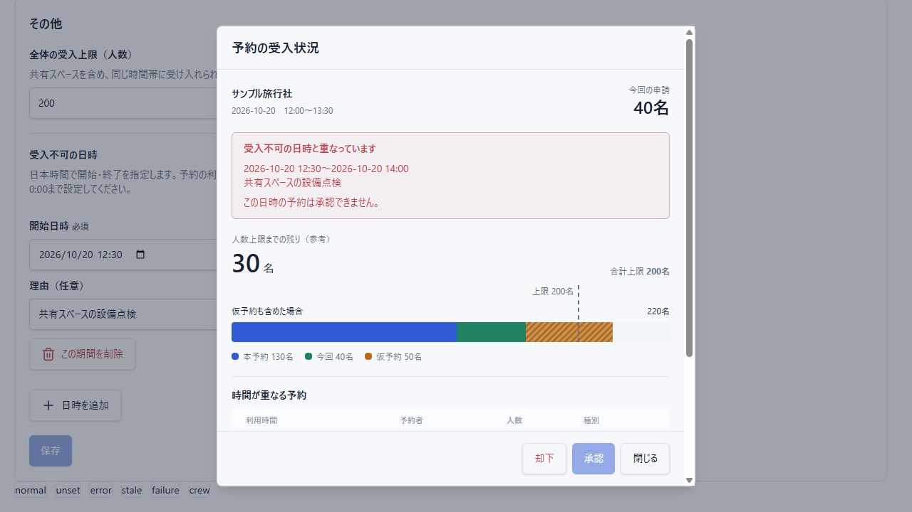

# 受入不可期間の設定（2026-10-16）

## 対応

- 「マスタ管理 → その他」に受入不可の日時を追加した。開始日時・終了日時・任意の理由（200文字以内）を複数登録・編集・削除できる。削除は確認後、保存で反映する。
- 日時は日本時間、分単位。終日は当日0:00〜翌日0:00、連続した複数日や日跨ぎも指定できる。定期的な曜日指定の繰り返し設定は今回追加していない。
- 存在しない日付、終了≦開始、200件超を検証する。初期値は空で、実運用の休業期間を任意に登録していない。
- 予約の利用時間が期間と少しでも重なれば、承認子画面に「受入不可」と該当日時・理由を表示し、承認を無効にする。却下・閉じるは引き続き利用できる。終了と次の開始が同時刻なら重複しない。
- 人数の集計バーと重なる予約は維持する。受入不可の場合の残り人数は参考値として表示する。
- 操作直前の再取得に加え、承認APIでも受入不可期間を確認する。該当する仮予約・本予約申請の承認は400で拒否し、状態変更・承認メールの登録前に停止する。本予約変更申請の却下で仮予約に戻す操作は妨げない。
- 既存予約を自動で却下・キャンセルしない。顧客の申請受付画面は変更していない。

## 保存

system_settings.blocked_periods（JSONB）に保存する。0006_large_legion.sqlをローカル開発DBに適用済み。既存の上限設定・予約を維持する。従来の上限のみの更新APIでは受入不可期間を保持し、空配列を指定した場合だけ全解除する。

## 検証

- npm test: 116件成功。
- ローカルPostgreSQLテスト: 32件成功。期間の保存・保持・解除、受入状況APIへの反映、承認拒否時の予約状態と通知件数維持、却下可能を確認した。
- npm run build: 成功。lintはエラー0、既存の警告5件。
- 実コンポーネントの隔離プレビューで、入力エラー、保存、削除確認、削除後の通常判定への復帰、受入不可表示、承認無効を確認した。幅390pxでも入力欄・説明文の横はみ出しなし。
- ブラウザー検証の保存先は検証用メモリのみ。実運用の期間や予約・メールは変更していない。実ログインから通知までの通し操作は未実施。

## 確認手順

localhost:3000の「マスタ管理 → その他」で「日時を追加」を選び、開始・終了・理由を入力して保存する。該当時間帯の承認待ち予約を開くと、子画面に受入不可と理由が表示される。

