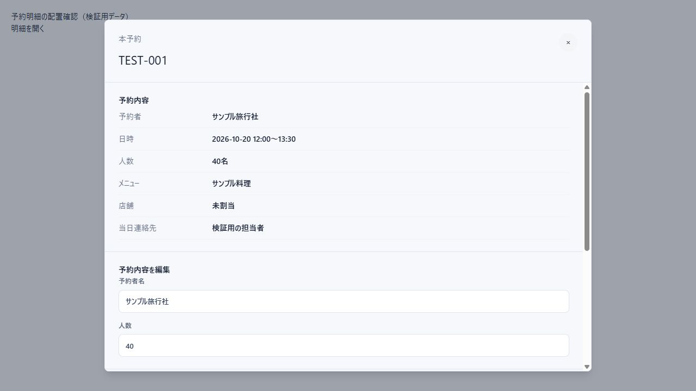

# 予約明細の中央表示（2026-10-16）

- 予約一覧・各管理一覧から選択した予約に共通するReservationDrawerを、承認画面と同じRadix Dialogの中央表示へ変更した。
- PCは最大896px、画面左右に余白を設け、スマートフォンは画面幅に合わせる。高さは画面の90%とし、ヘッダーを残して本文を内部スクロールする。
- 明細は項目名と内容を列で揃え、長い内容を折り返す。既存の編集・店舗割当・確認連絡・ステータス操作は維持する。
- 閉じるボタンに名前を付けた。予約内容の保存中は閉じる操作を無効にする。
- 新規予約入力と顧客編集は今回の「明細クリック」の対象外。
- npm test:116件成功。npm run build:成功。
- 共通の実ダイアログと検証用明細で、PC1280×720では幅896px・左右192px、スマートフォン390×844では幅358px・左右16pxの中央配置を確認した。本文スクロールと閉じる操作も確認した。
- ログインした実管理画面から更新を実行する通し検証は未実施。API・DB変更はない。

