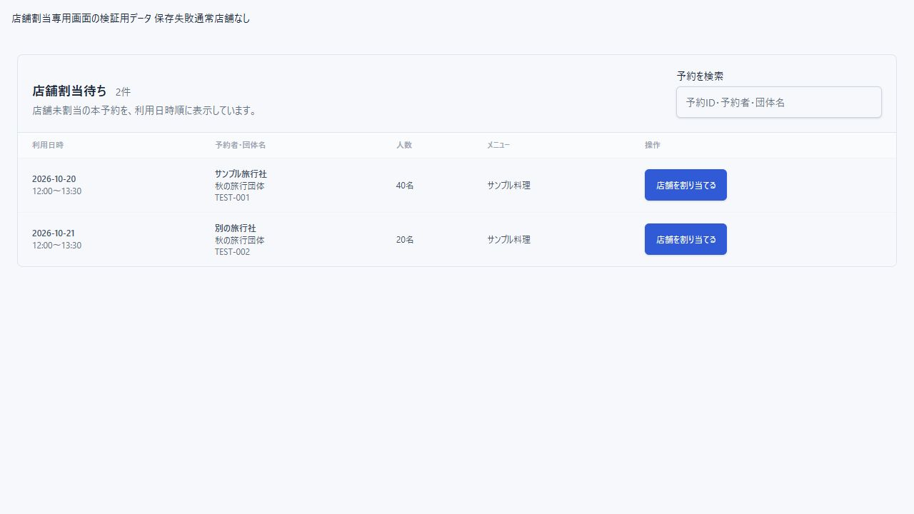
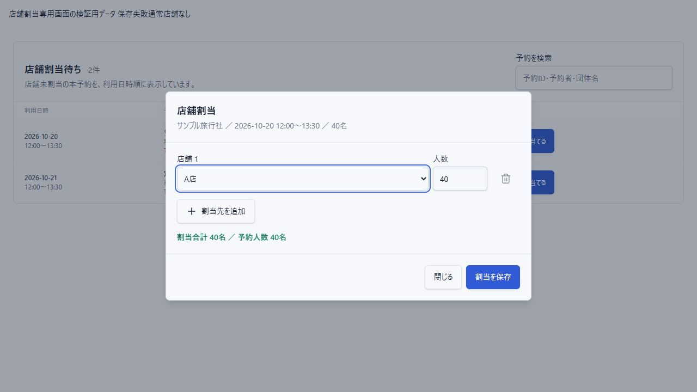

# 店舗割当専用画面（2026-10-16）

## 対応

- ダッシュボードの「店舗割当」の遷移先を、予約一覧の状態フィルタから専用の店舗割当画面に変更した。左メニューにも店舗割当を追加した。
- ダッシュボード件数と同じ条件（本予約・来店待ち、割当なし）で対象を表示する。利用日時順とし、予約ID・予約者・団体名で検索できる。予約一覧の検索・フィルタ状態と独立している。
- 予約日時・予約者・団体名・人数・メニューと「店舗を割り当てる」を表示する。狭い画面は横スクロールし、操作列は右側に固定する。
- 操作から中央表示の店舗割当専用ダイアログを開く。店舗と人数の入力、行追加・削除、合計人数の確認と保存に絞った。複数店舗に分割できる。
- 有効店舗の選択、正の整数、予約人数と合計の一致をReact Hook Form・Zodで検証する。APIの既存の人数検証・権限・自動ステータス更新は維持する。
- 保存結果を親へ返すようにし、成功時だけダイアログを閉じ、割当待ちから外す。失敗時は内容を残してメッセージを表示する。保存中の二重操作・閉じるを無効にする。
- 読込中・取得失敗・対象なし・検索該当なし・有効店舗なしに対応した。

## 検証

- npm test:118件成功。npm run build:成功。lintはエラー0件、既存警告5件。
- 実コンポーネントを使用する隔離プレビューで、割当済み予約の除外、2店舗への分割（30+10名）、人数不一致エラー、成功後の2件→1件への更新、失敗時の店舗・人数保持、有効店舗なしの操作無効を確認した。
- 幅390pxで文書幅390px、子画面幅358px・左右16px。割当ボタンが表示範囲内に残ることを確認した。
- 実ログインからローカルDBへの割当保存までの通し操作は未実施。ブラウザー検証は検証用メモリだけを変更した。今回API・DBスキーマは変更していない。
- 前回の締切設定のローカルDB反映保留（記録21）は今回解消していない。

## 確認

localhost:3000でダッシュボードの店舗割当、または左メニューの店舗割当を開く。「店舗を割り当てる」から店舗と人数を入力して保存する。

## 表示統一の追加修正

店舗割当の件数バッジを確認連絡と同じ赤い背景・文字サイズ・余白に統一した。アイコンは店舗を表す形を使用し、色は共通のメニュースタイルを継承する。
