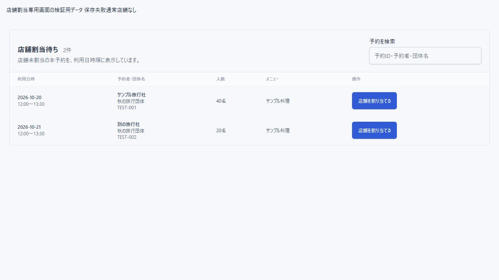
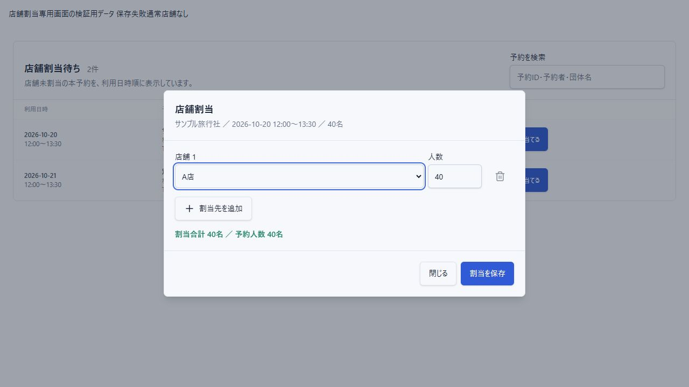

# 店舗割当専用画面（2026-10-16）

## 2026-11-10追加仕様（採用）

- 店舗割当専用ダイアログと予約詳細の割当編集は、有効な全店舗を表示順にあらかじめ並べ、人数だけを入力する。店舗数はマスタから取得し、3件に固定しない。店舗選択・行追加・行削除の操作を廃止する。
- 新規割当の初期人数は各店舗0名。0名・空欄の店舗は未使用とし、人数のある店舗だけを既存APIへ渡す。負数・小数・予約人数を超える人数を拒否し、割当合計を予約人数に合わせる。
- 既存割当は保存値を反映し、有効一覧にない保存済み店舗も「現在の割当」として表示する。同一店舗の重複した旧データは人数を合算して1行に表示し、合計人数を保持する。無効店舗を新規には割り当てない。
- 店舗マスタの再取得でも入力を保持し、新店舗は0名で追加する。入力中の店舗が無効化された場合も入力を表示して修正できるようにし、保存済み割当でない無効店舗へ新規割当することは拒否する。
- 予約詳細の編集で全店舗を0名にすると、確認ダイアログから既存の割当解除（空配列）を実行できる。専用の新規割当画面では全店舗0名の保存を許可しない。
- React Hook Form・Zodと共通の`StoreAssignmentForm`を使用。項目別エラー、保存中の無効化、失敗時の入力保持を両方の入口で共通化し、成功時だけ編集を閉じる。
- API・DB・認証・割当人数の照合・自動ステータス更新は変更しない。以下の2026-10-16の操作記録より、この追加仕様を優先する。

実装: `app/reservations/components/store-assignment-form.tsx`、`lib/store-assignment-form.ts`。検証区分はUI操作・状態・入力検証。型チェック・Lint・通常テスト・検証ビルドと、架空データによるPC1280px／スマートフォン390pxの画面確認を実施した。API・DB・認証は変更していないためDB／認証テストは対象外。

### 2026-11-10検証結果

- `npm run typecheck`成功、最終コードでの`npm run lint`は警告0件、`npm test`は210件成功・失敗0。全店舗の初期表示、0名の除外と既存APIとの互換性、不正人数と合計不一致の拒否、無効店舗の保持・新規割当拒否、店舗再取得時の入力保持の4テストを追加した。
- `npm run build:check`成功（隔離設定で`npm run build`を実行）。一時画面削除後の古い生成型で初回は停止したが、該当する生成型だけを除去して再実行し成功した。
- 実コンポーネントを使い、3店舗が選択・追加操作なしで初期表示されること、10名＋5名＋0名の保存内容に0名店舗が含まれないこと、合計不一致エラー、保存失敗時の入力保持と再保存を確認。
- 保存済み無効店舗の人数表示、全店舗0名での解除確認・取消・解除後の空配列保存を確認。PC1280×900・スマートフォン390×844で表示し、スマートフォンのページ幅・スクロール幅は390px、ダイアログの内容幅・スクロール幅は356pxで横はみ出しなし。
- 既存の開発サーバー上の一時画面と架空データ・模擬保存処理を使用。確認後は一時画面を削除した。実DB・実メール・アカウント・認可の変更は行っていない。
- 証跡（Git対象外）: `docs/review-artifacts/store-assignment-all-stores-2026-11-10/desktop.jpg`、`mobile.jpg`。

## 対応

- ダッシュボードの「店舗割当」の遷移先を、予約一覧の状態フィルタから専用の店舗割当画面に変更した。左メニューにも店舗割当を追加した。
- ダッシュボード件数と同じ条件（本予約・来店待ち、割当なし）で対象を表示する。利用日時順とし、予約ID・予約者・団体名で検索できる。予約一覧の検索・フィルタ状態と独立している。
- 予約日時・予約者・団体名・人数・メニューと「店舗を割り当てる」を表示する。狭い画面は横スクロールし、操作列は右側に固定する。
- 操作から中央表示の店舗割当専用ダイアログを開く。店舗と人数の入力、行追加・削除、合計人数の確認と保存に絞った。複数店舗に分割できる。
- 有効店舗の選択、正の整数、予約人数と合計の一致をReact Hook Form・Zodで検証する。APIの既存の人数検証・権限・自動ステータス更新は維持する。
- 保存結果を親へ返すようにし、成功時だけダイアログを閉じ、割当待ちから外す。失敗時は内容を残してメッセージを表示する。保存中の二重操作・閉じるを無効にする。
- 読込中・取得失敗・対象なし・検索該当なし・有効店舗なしに対応した。

## 検証

- npm test:118件成功。npm run build:成功。lintはエラー0件、既存警告5件。
- 実コンポーネントを使用する隔離プレビューで、割当済み予約の除外、2店舗への分割（30+10名）、人数不一致エラー、成功後の2件→1件への更新、失敗時の店舗・人数保持、有効店舗なしの操作無効を確認した。
- 幅390pxで文書幅390px、子画面幅358px・左右16px。割当ボタンが表示範囲内に残ることを確認した。
- 実ログインからローカルDBへの割当保存までの通し操作は未実施。ブラウザー検証は検証用メモリだけを変更した。今回API・DBスキーマは変更していない。
- 前回の締切設定のローカルDB反映保留（記録21）は今回解消していない。

## 確認

localhost:3000でダッシュボードの店舗割当、または左メニューの店舗割当を開く。「店舗を割り当てる」から店舗と人数を入力して保存する。

## 表示統一の追加修正

店舗割当の件数バッジを確認連絡と同じ赤い背景・文字サイズ・余白に統一した。アイコンは店舗を表す形を使用し、色は共通のメニュースタイルを継承する。
