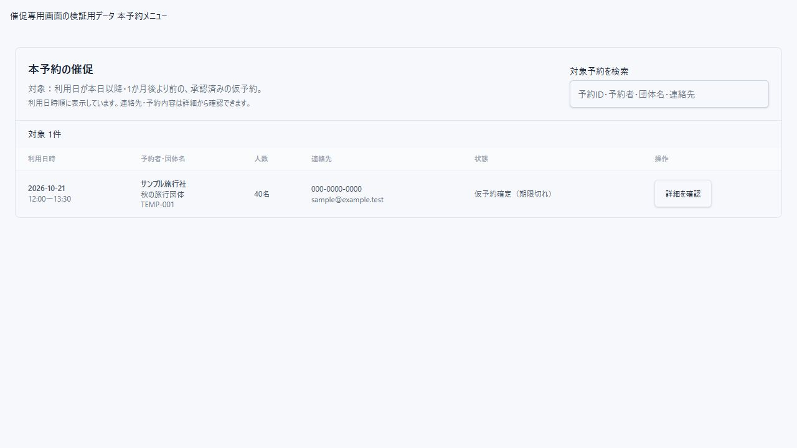
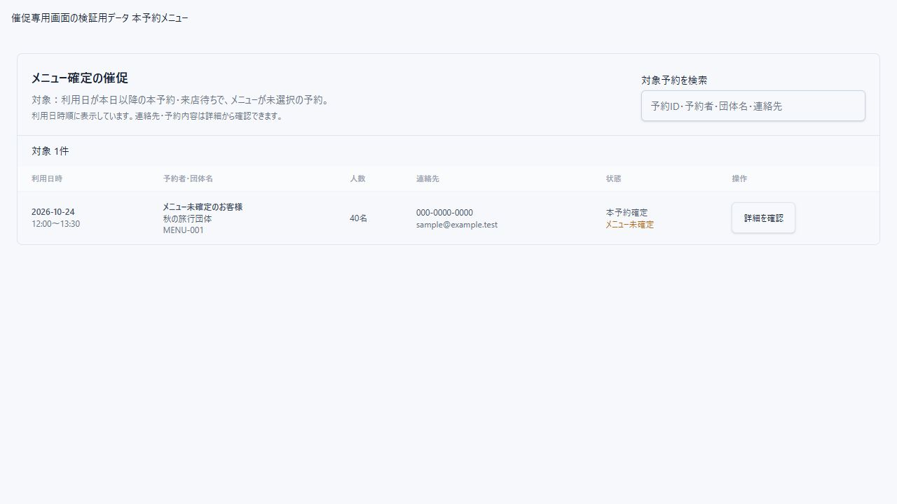

# 本予約・メニュー確定の催促専用画面（2026-10-16）

## 変更

- ダッシュボードの「本予約の催促」「メニュー確定の催促」から、それぞれの専用画面へ遷移するようにした。予約一覧のフィルタは変更せず、検索・ステータス選択・利用日期間の影響を受けない。
- 本予約の催促：利用日が本日以降かつ今日の1か月後より前の、仮予約承認済み予約。1か月後ちょうどは対象外。
- メニュー確定の催促：利用日が本日以降の本予約・来店待ちで、menuItemsが未選択の予約。
- 過去の利用日を催促対象から除外した。ダッシュボードの件数と専用画面で共通の判定関数を使用し、条件を統一した。
- 対象条件・対象件数を画面に表示し、利用日時順で一覧化する。専用画面内の検索は独立し、検索時は対象件数と表示件数を分けて表示する。検索解除を用意した。
- 利用日時、予約者・団体名、人数、連絡先、状態を表示する。「詳細を確認」は既存の中央表示の予約明細を開き、既存の編集機能を利用する。メールの送信処理は追加していない。
- 読込中・取得失敗・対象なし・検索該当なしを表示する。狭い画面では表を横スクロールし、操作列を固定する。

## 検証

- npm test：120件成功。過去日除外、本日を含むこと、1か月後の境界、月末、対象ステータス、メニュー選択済み除外を確認した。
- npm run build：成功。lintはエラー0、既存警告5件。
- 実コンポーネントを使用した隔離プレビューで両画面の対象・件数、検索該当なし、画面切替時の検索条件の独立を確認した。
- 幅390pxで文書幅390px、詳細ボタンが画面内に収まり高さ44pxであることを確認した。
- プレビューの詳細ボタンは保存・実予約操作を行わない。実ログインから詳細編集までの通し操作は未実施。API・DB変更なし。

## サイドバー導線の追加

本予約の催促・メニュー確定の催促を店舗割当の下に追加した。件数バッジは他メニューと同じ赤背景・文字サイズを使用する。長い名称が収まるようPCのサイドバー幅と本文余白を272pxに揃え、短い画面ではサイドバー内をスクロールする。実マークアップの隔離プレビューで両メニューの選択状態への切替を確認した。
