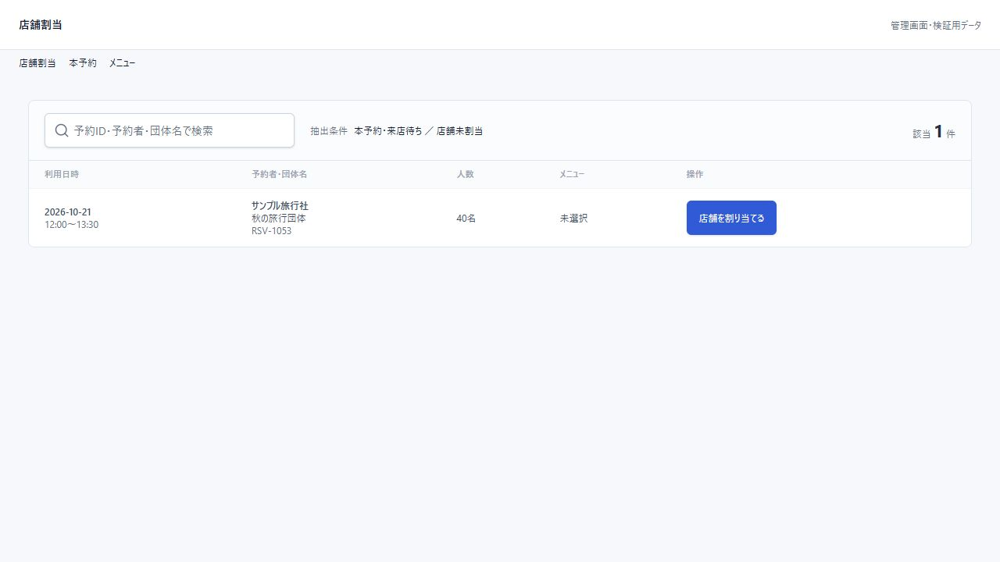
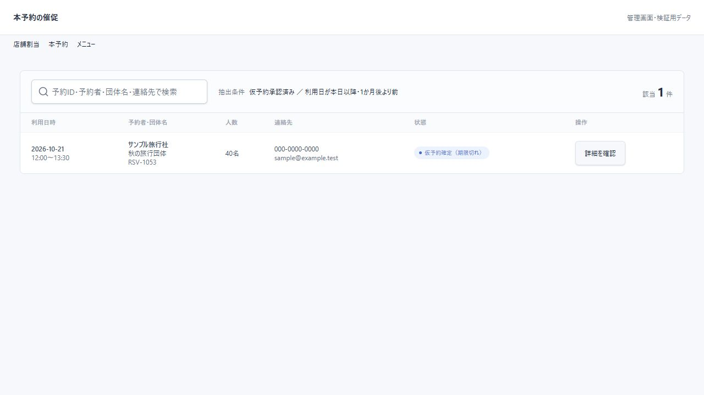
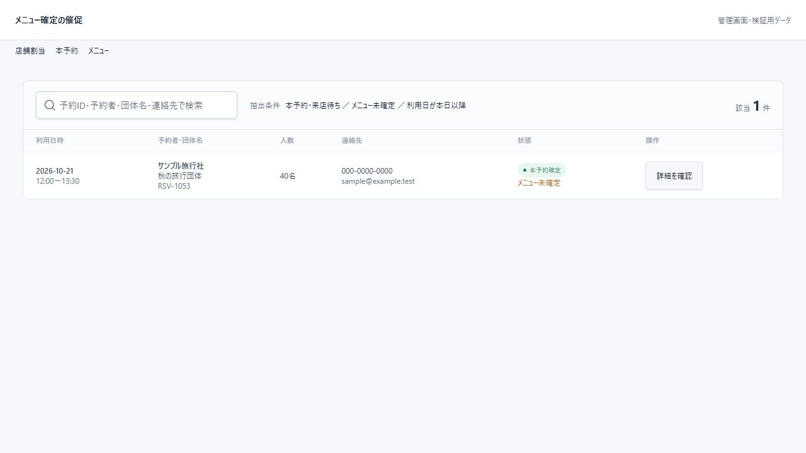

# 店舗割当・催促画面のデザイン統一（2026-10-16）

- 対象は店舗割当、本予約の催促、メニュー確定の催促の3画面。
- 共通のReservationWorklistで、予約一覧・予約承認と同じく上部のページ名だけを表示する。パネル内の重複タイトル・長い案内文を削除した。
- 検索と抽出条件を上部ツールバー左側に配置し、表示中の件数を右側に「該当 ○ 件」で表示する。検索解除も同じツールバーに置く。
- 条件は「本予約・来店待ち／店舗未割当」「仮予約承認済み／利用日が本日以降・1か月後より前」「本予約・来店待ち／メニュー未確定／利用日が本日以降」と簡潔に表示する。
- パネルと明細行はcardトークンの白背景に統一。列見出しは薄い背景、明細文字は12px、催促画面のステータスは既存のバッジを使用する。
- 件数文字・数字のサイズは予約承認の表示に揃えた。狭い画面では検索を上段、条件と件数を下段に配置し、表は横スクロール、操作列は固定する。
- 対象抽出、ダッシュボード件数、保存API、子画面の処理は変更していない。

検証：npm testは120件成功、npm run build成功。lintはエラー0・既存警告5件。実コンポーネントの隔離プレビューで3画面を確認し、ページタイトルが1つ、行の背景がrgb(255,255,255)、件数が右上にあることを確認した。幅390pxで文書幅390pxを確認し、検索で1→0件、解除で1件に戻ることも確認した。実ログインによる更新操作・メール送信は未実施。

## フィルタ外観の追加修正

文章で並べた抽出条件を削除し、予約一覧で使うreservation-date-rangeと同じスタイルの項目欄に変更した。予約日・ステータス・メニュー・担当店舗を分けて表示する。専用画面の対象条件は固定のまま、検索は従来どおり操作できる。実表示で高さ42px・白背景・既存と同じ枠線を確認した。幅390pxでも横はみ出しなし。

## 最終仕様：検索欄だけ表示

ユーザー指定により、3画面の予約日・ステータス・メニュー・担当店舗の条件欄はすべて削除した。予約一覧と同じreservation-searchを使い、文言は「予約ID・顧客名で検索」、PC幅320px・高さ42px。検索対象は予約IDと顧客名のみ。対象抽出の内部ルールは維持する。入力欄1個・追加条件欄0個、幅390pxで横はみ出しなしを確認した。前節の項目別条件表示はこの仕様で置き換える。
