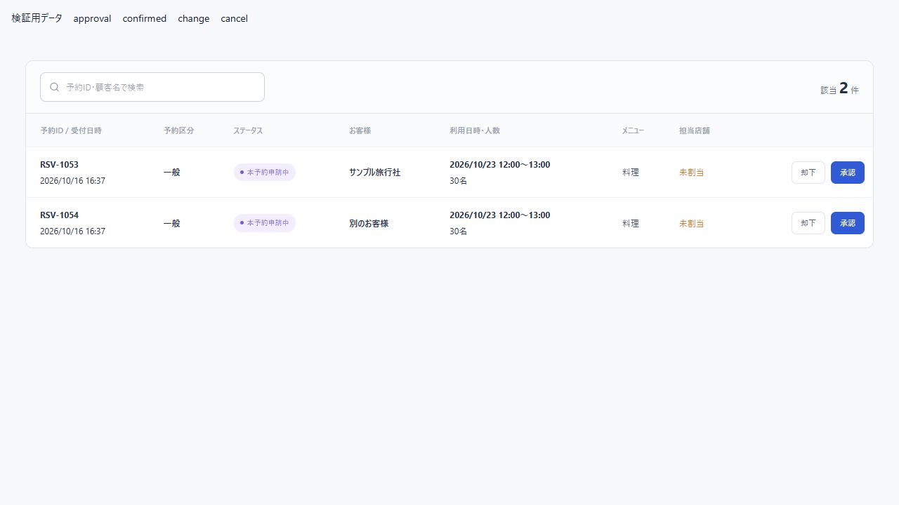

# 承認4画面への検索追加（2026-10-16）

- 予約承認、本予約変更承認、予約変更承認、キャンセル承認に「予約ID・顧客名で検索」を追加した。
- 店舗割当・催促画面と共通のReservationSearchToolbarを使用し、予約一覧と同じ検索欄のスタイルを使う。
- 予約IDまたは顧客名の部分一致、大文字・小文字の区別なし、前後空白を除去して検索する。予約変更承認は変更申請IDではなくreservationIdと顧客名を検索する。
- 「該当 ○ 件」は検索結果の件数。検索該当なしと未対応申請なしの表示を区別する。
- 各画面で検索状態を独立させ、承認・却下・明細選択の処理は維持した。API・DB変更なし。
- npm test：120件成功。npm run build：成功。既存の静的回帰テストを共通検索欄・絞り込み後の件数に合わせて更新した。
- 実際の4画面の関数を使った隔離プレビューで、各2件から予約IDで1件、顧客名で1件、該当なしで0件になることを確認した。予約変更承認でも予約ID検索を確認した。
- 幅390pxで文書幅390px、検索入力幅271pxを確認した。ブラウザーで承認・却下を実行せず、実データは変更していない。

