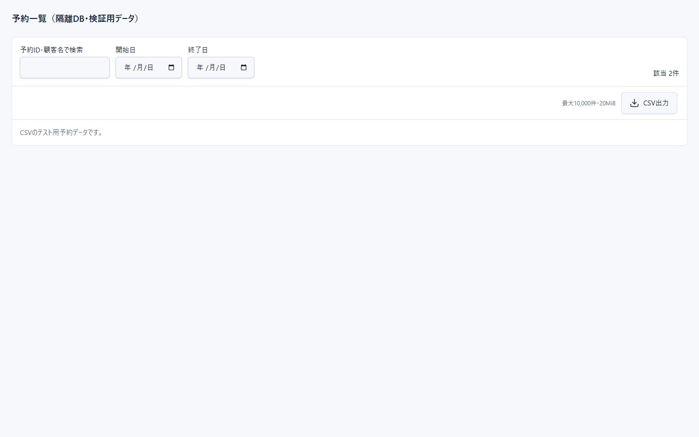
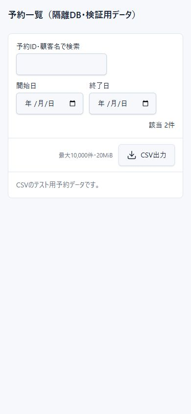

# 予約CSV出力の実装記録（2026-10-19）

## 実装範囲と使い方

承認済み仕様に従い、予約一覧の検索欄と明細の間に「CSV出力」を追加した。現在の検索文字・予約日・ステータス・既存の業務フィルタ・並び順を適用し、ページに関係なく全件出力する。出力開始時の条件を固定し、作成中はボタンを無効化する。0件はメッセージのみ表示し、失敗時もファイルを作らない。

対象は既存の全体管理者およびDrizzle構成。既存の認証方式、DBスキーマ、予約の検索仕様は変更していない。実利用の予約データの更新・削除は行っていない。請求機能は追加していない。

## 構成とデータ取得

- `POST /api/reservations/export` のNode.js Route Handlerで生成する。Server Actionは使用しない。
- 一覧の絞り込み・ソート・表示ステータスを `lib/reservation-search.ts` に共通化し、一覧とCSVで再利用する。逆順の日付範囲も既存一覧同様に正規化する。
- リクエストをZodで検証する。未定義キー、店舗・ユーザー等の独自スコープ指定、不正日付、ステータス、ソート指定は拒否する。
- Drizzleの安全な条件式で日付・ステータスを絞り、読み取り専用のrepeatable readトランザクションで500件ずつ取得する。受付日時と内部IDを取得カーソルに使い、メニュー・店舗割当も同じスナップショットで取得する。
- 現在の一覧と同じ検索関数で最終判定し、CSV行とソート値だけを上限内で保持する。全モデルを全件メモリに保持しない。アカウント情報のJOINは不要で、予約に保存された申請情報を出力する。
- 主ソート値が同じ場合は安定ソートとなる。一覧の同一受付日時の順序には従来明確な保証がなく、CSV側は取得カーソルの内部ID順で安定させる。

## 出力項目（31列、順序固定）

| 日本語ヘッダー | 参照値・表現 |
| --- | --- |
| 予約ID | 公開予約番号 `id`（RSV等） |
| 受付日時 | `received`、日本時間 |
| 予約区分 | `bookingType` の日本語表示 |
| 利用者区分 | `accountType` の日本語表示 |
| ステータス | 一覧と共通。仮予約期限切れも反映 |
| 予約者名・会社名 | `customer` |
| 会社・支店名 | `companyBranchName` |
| 旅行会社担当者名 | `contactPersonName` |
| 団体名 | `groupName` |
| 団体名フリガナ | `groupNameKana` |
| 団体区分 | `groupType` |
| 団体区分その他 | `groupTypeOther` |
| 利用日 | `date`、YYYY-MM-DD |
| 開始時刻 | `startTime`、HH:mm、未設定は空欄 |
| 終了時刻 | `endTime`、HH:mm、未設定は空欄 |
| 予約人数 | `people`、数値 |
| T/C人数 | `tcCount`、数値。予約人数に加算しない |
| DG人数 | `dgCount`、数値 |
| メニュー | メニュー名を ` / ` で連結 |
| 店舗割当 | `店舗名：6名 / 店舗名：6名` の形式 |
| 予約担当者名 | `bookingContactName` |
| 当日連絡先氏名 | `dayContactName` |
| 当日連絡先電話番号 | `dayContactPhone` |
| 電話番号 | `phone` |
| メールアドレス | `email` |
| 住所 | `address` |
| 備考 | `remarks` |
| 予約金額（円） | 既存の `totalAmount`。メニュー明細の数量×単価の既存計算値 |
| 支払条件 | `paymentCondition` の日本語表示 |
| 確認連絡状況 | 確認連絡日時の有無から連絡済み／未連絡 |
| 確認連絡日時 | `confirmationContactedAt`、日本時間 |

金額に税額・キャンセル料等を新たに加算しない。1予約1行とし、内部UUID、認証情報、送信エラー情報等は出力項目に含めない。日時はAsia/Tokyoの `YYYY-MM-DD HH:mm:ss`、数値は桁区切りなし。未設定文字列は空欄。

## ファイルと安全化

- UTF-8 BOM付き、カンマ区切り、ヘッダーあり、CRLF。セル内の改行もCRLFに正規化する。
- 全セルをダブルクォートで囲み、セル内のダブルクォートを二重化する。カンマ・引用符・改行によるセル境界操作を防ぐ。
- 自由入力文字列と型付き数値を区別する。文字列は先頭の空白・制御文字・不可視書式文字を読み飛ばした位置の `= + - @` と全角相当文字を検査し、危険な場合だけ先頭にタブを追加する。CSVエスケープとは別処理とし、正当な負の数値は改変しない。
- ファイル名は日本時間の `reservations_YYYYMMDD_HHmmss.csv`。
- 仕様参考：[RFC 4180](https://www.rfc-editor.org/rfc/rfc4180)、[OWASP CSV Injection](https://community.owasp.org/attacks/CSV_Injection)。安全化はすべての表計算ソフトや再保存後の解釈を保証するものではない。

## 認可・個人情報・負荷対策

- 既存 `requireAdmin` をAPIで適用する。未認証401、非管理者403。CSVを返す直前にも失効・権限を再確認する。ボタン表示だけに依存しない。現行は全体管理者のため店舗・テナント別権限はない。将来スコープが導入される際はDB条件への追加が必要。
- 同一オリジンの確認、JSON本文8KiB上限、厳格なスキーマ検証を実施。
- `Cache-Control: private, no-store`、`Content-Type: text/csv; charset=utf-8; header=present`、添付ファイルの `Content-Disposition`、`X-Content-Type-Options: nosniff` を設定する。運用公開時はHTTPSを前提とする。ダウンロードされたファイル自体は利用者の端末に保存される。
- 最大10,000件、BOM・ヘッダー込み20MiB、リクエスト開始から30秒。超過は条件を絞る案内を返し、不完全なCSVは返さない。DBのstatement_timeoutにも残り時間を適用する。
- 最終検索前の走査件数にも50,000件上限を設ける。キーワードだけの広い条件では該当が少なくても走査上限に達する場合があるため、日付等で絞り込む。
- 既存の永続レート制限を使い、ユーザー毎2回/分・20回/時、全体10回/分。同時生成はプロセス毎2件まで。複数プロセスにまたがる同時実行数の完全制御は未実装。
- CSV内容・検索語・個人情報・生の内部例外をログに出さない。監査ログは操作ID、UIDのSHA-256、結果、件数、所要時間。`generated` は生成成功であり端末保存完了の証明ではない。ログの保管期間・閲覧権限は運用設定で管理する。

## 検証結果

- `npm test`：134件成功、失敗0。
- `npm run test:db:postgres -- --confirm reservation_system_test`：37件成功、失敗・スキップ0。明示したローカル専用テストDBのみ初期化し、開発用DBは変更しない。CSVを含めテストは直列実行する。
- `npm run build`：成功。
- `npm run lint`：エラー0、既存警告5件。
- 501件を超える実SQL取得、検索・日付・ステータス・並び順、権限401/403、スコープ指定拒否、SQL風検索語、0件、制限429、権限再確認、内部例外の秘匿、30秒タイムアウトを検証した。
- BOM、日本語、31列、引用符・カンマ・セル内改行、日本時間、住所・備考・金額、複数店舗割当、数式の安全化、10,000件成功と10,001件拒否、20MiB超過拒否を検証した。
- 10,000件の生成単体測定例：7,809,448 bytes、約796ms、ヒープ増分約34MiB。DB取得を含まない測定であり、ピークメモリや実運用の所要時間を保証しない。
- 実コンポーネントとRoute Handlerを隔離DBの架空データで接続し、ダウンロード、作成中の無効状態、0件案内、出力開始後に画面の検索語を変更しても開始時条件で出力されることをブラウザで確認した。
- PC幅1440px・スマートフォン幅390pxで追加操作欄を確認した。画像は隔離した確認画面であり、管理者ログインを含めた本番画面全体の通し確認とは区別する。

## 未確認事項・残存リスク

- Excelの従来のテキスト取り込みウィザードではUTF-8として日本語が認識されることを確認したが、セル内改行のプレビューに問題があり、取り込みをキャンセルした。通常オープン確認に必要な補助アプリの操作承認がタイムアウトしたため、**Excelでの取り込み完了および実際の数式解釈は未確認**。安全化とRFC形式は自動テストで確認済み。Excelの「データ→テキスト/CSVから」での通し確認を今後の検証候補とする。
- 電話番号等はCSVに文字列のまま保持するが、Excelの自動型判定で先頭ゼロが消える場合がある。取り込み時に電話番号列を文字列に指定する。危険な文字列には安全化用の先頭タブが残る。
- 20MiB以内のCSVは全体のサイズと並び順を確定してから返す。無制限ストリーミングや非同期ジョブは導入していない。より大きな出力や分散構成が必要になった段階で共有キュー・分散同時実行制御を検討する。
- 一覧を開いてから予約が更新された場合、CSVは出力時点のDBスナップショットになる。画面に残った古い明細と完全一致することは保証しない。

## 主な追加・変更ファイル

- `app/api/reservations/export/route.ts`：HTTP・既存認可・制限・監査ログ。
- `app/reservations/components/reservation-csv-export.tsx`：CSV操作UI。
- `app/page.tsx`、`app/reservations/formatters.ts`：共通検索処理の利用とボタン配置。
- `lib/reservation-search.ts`、`lib/reservation-export-validation.ts`、`lib/reservation-export-policy.ts`：検索・検証・制限。
- `lib/csv/encoding.ts`、`lib/csv/reservation-export.ts`：安全化・CSV形式・明示的な列定義。
- `lib/services/reservation-export-service.ts`：生成・上限制御。
- `lib/repositories/reservation-repository.ts`、`lib/repositories/drizzle-reservation-repository.ts`：分割取得インターフェースと実装。
- `tests/reservation-export.test.ts`、`tests/db/reservation-export.test.ts`：正常・異常・セキュリティ検証。
- `tests/reservation-ui-regression.test.ts`：共通化後の回帰検証。
- `tests/db/calendar-fixture.ts`、`scripts/test-postgres.ts`：専用テストDBでのSQL検証。

新規ライブラリ・スキーマ移行は追加していない。

## 追加修正：開始メッセージの自動消去

「CSVダウンロードを開始しました。」は表示から5秒後に自動消去する。再出力時と画面を離れた際には前回のタイマーを解除する。これはブラウザへのダウンロード開始通知であり、端末への保存完了を検知して消す仕組みではない。対象0件・失敗の案内には今回の自動消去を適用しない。

利用者の指定により、操作欄の「最大10,000件・20MiB」は非表示にした。サーバー側の上限制御は維持している。
